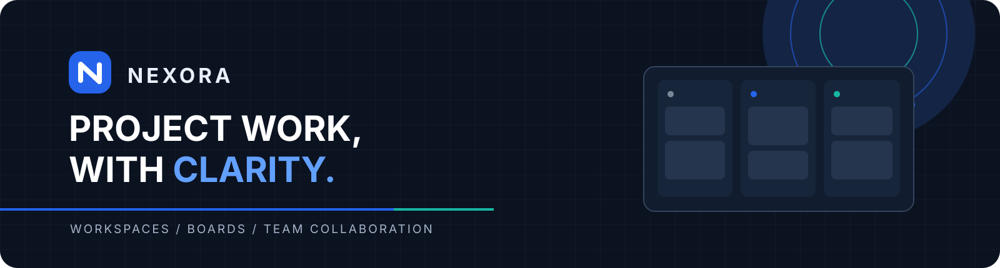
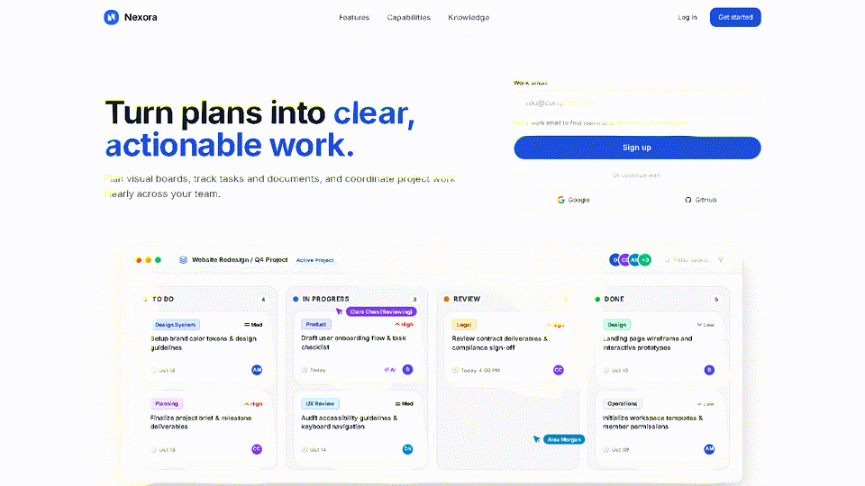

   

Nexora is a team project management platform built around workspaces, project boards, cards, and collaboration. It is a university software engineering project maintained across three repositories: frontend, backend, and an AI service in its foundation phase.

## Project tour

*A short tour of the landing page and core workspace screens. App screenshots were provided from a local run and contain sample project data; they do not represent a hosted live demo.*

## Repositories

| Repository | Focus |
| --- | --- |
| [Nexora-FE](https://github.com/NEXORA-UIT/Nexora-FE) | React, TypeScript, and Vite frontend for workspaces, boards, cards, calendar, and account flows. |
| [be](https://github.com/NEXORA-UIT/be) | Express and TypeScript API for authentication, permissions, project data, realtime updates, and background jobs. |
| [ai](https://github.com/NEXORA-UIT/ai) | Python and FastAPI foundation for planned document retrieval and AI-assisted workflows. |

## Engineering highlights

- **Domain model:** Workspace → Board → List → Card → Task. A Board represents a project; a Task is a checklist item within a Card.
- **Authorization:** The backend checks access to workspace and Board data in its service layer.
- **Realtime collaboration:** REST owns persistent changes; Socket.IO distributes updates to connected clients.
- **API contracts:** OpenAPI documentation supports coordination between the frontend and backend.
- **Incremental AI work:** The AI repository documents future ingestion and retrieval boundaries separately from the public API.

## AI service status

The AI repository currently provides a FastAPI health endpoint and a read-only PostgreSQL/pgvector connectivity check. Document ingestion, retrieval, and answer generation are planned and are not yet integrated into the product. See the [AI repository](https://github.com/NEXORA-UIT/ai) for its current implementation and the [RAG architecture notes](https://github.com/NEXORA-UIT/ai/blob/main/docs/rag-architecture.md) for the agreed future boundary.

## Start reading

Setup and code structure are documented in each repository's README: [frontend](https://github.com/NEXORA-UIT/Nexora-FE#readme), [backend](https://github.com/NEXORA-UIT/be#readme), and [AI service](https://github.com/NEXORA-UIT/ai#readme). For technical details, see the [frontend architecture notes](https://github.com/NEXORA-UIT/Nexora-FE/blob/main/agent-docs/ARCHITECTURE.md) and [backend API docs](https://github.com/NEXORA-UIT/be/tree/main/docs/api).
